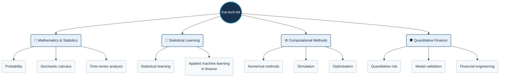

# 👋 Hi, I'm Kai-tech-bit

### Mathematics · Statistical Learning · Financial Engineering · Quantitative Risk

I’m interested in how mathematical models help us understand financial
uncertainty—and where their assumptions stop being reliable.

My focus brings together probability, statistics, stochastic calculus,
time-series analysis and applied machine learning, with an emphasis on
quantitative risk, model validation and financial engineering.

## 🌐 My Quantitative Landscape

## 🔬 What I'm Building

I’m developing independent quantitative-finance case studies that connect
mathematical reasoning with practical Python implementations, careful
validation and clear explanations.

Areas I’m interested in exploring include:

- 📊 Portfolio risk, stress testing and scenario analysis
- 📈 Derivatives pricing and Monte Carlo simulation
- 🔍 Model validation, benchmarking and sensitivity analysis
- 🤖 Statistical learning for financial data
- ⚙️ Numerical methods and optimisation in finance

My aim is to make each study understandable and reproducible:
a clear question, explicit assumptions, transparent calculations
and an honest discussion of the results.

## 🧠 How I Work

**Understand the mathematics. Question the assumptions. Test the results.**

I value depth over a long list of techniques. I’m interested not only in
whether a model produces an answer, but also in why it behaves as it does,
how sensitive it is to its inputs and when its conclusions may be misleading.

I use Python as a practical tool for exploring ideas, implementing models
and communicating findings through analysis and visualisation.

## 📚 What I'm Deepening

My ongoing study centres on statistical learning, financial mathematics,
time series and computational methods.

The goal is to connect theory with implementation—and explain both
the capabilities and limitations of the methods I use.

## 🤝 Connect

Open to thoughtful discussions and collaborations in quantitative risk,
financial engineering, applied machine learning and statistical modelling.

📫 [abilfazalunwala786110@gmail.com](mailto:abilfazalunwala786110@gmail.com)

---

*Curiosity in the mathematics. Care in the modelling. Clarity in the explanation.*
